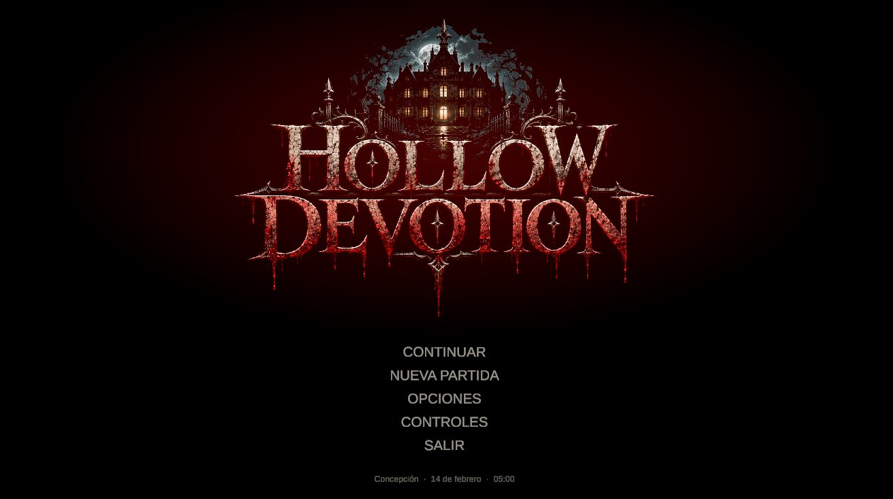
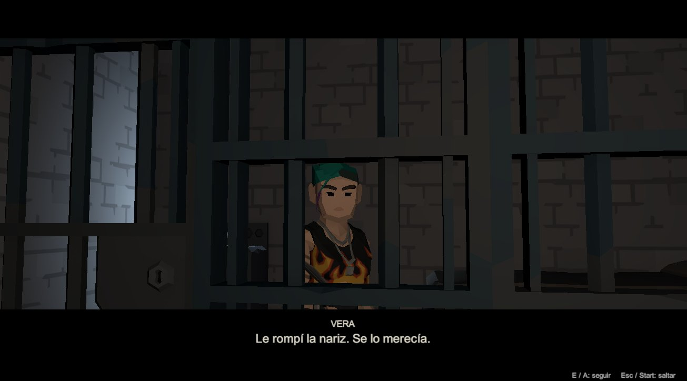
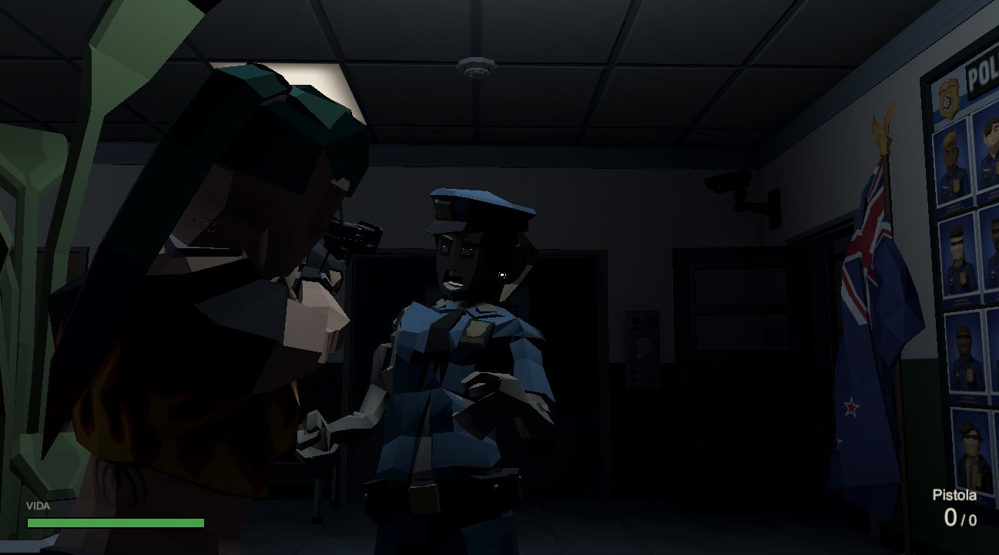
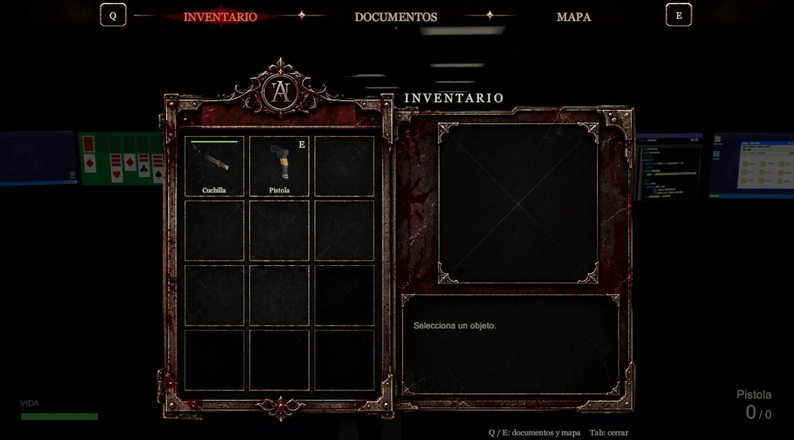
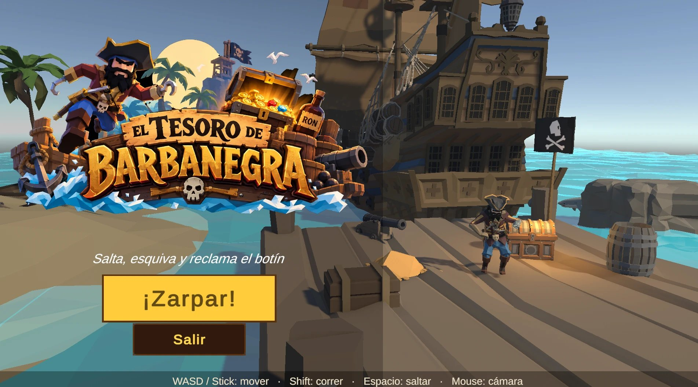
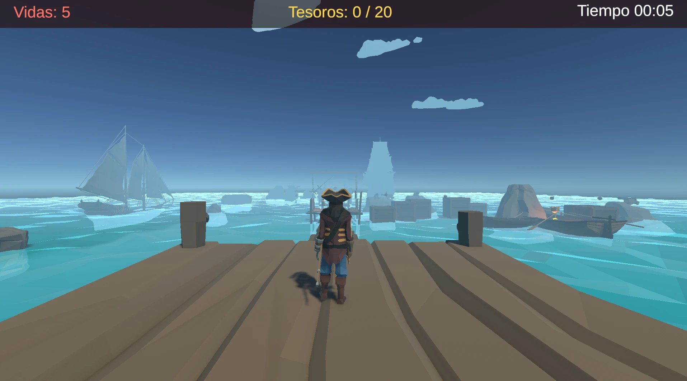
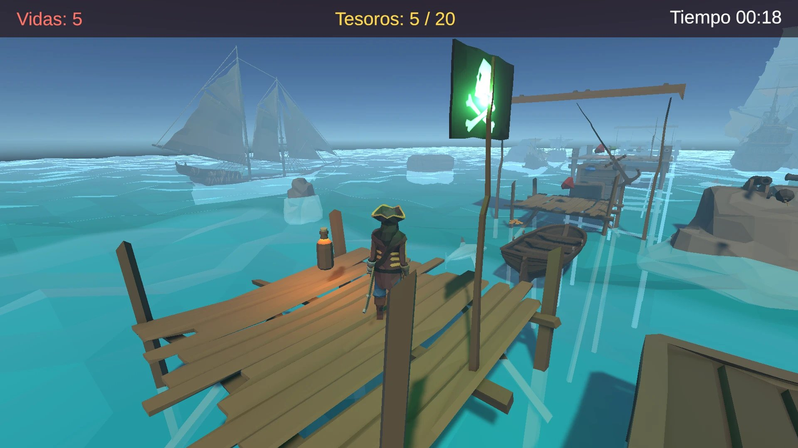
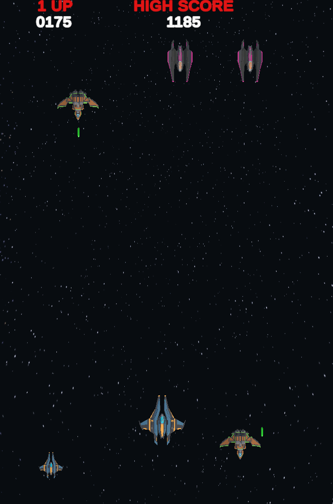

# Videojuegos en Unity

Tres juegos desarrollados para el ramo **Desarrollo de Videojuegos** de Ingeniería
Civil Informática en la UCSC (2026), en dupla con
[Luis Felipe Núñez](https://github.com/lufenunez). En el desarrollo nos repartimos
el trabajo de forma pareja: programación de scripts en C#, integración de assets,
diseño de niveles y pruebas.

> Este repositorio es una vitrina: muestra cada juego con capturas y una
> descripción. El código no se publica porque los proyectos usan paquetes de
> assets con licencia que no permite redistribuirlos.

| Juego | Género |
|---|---|
| [Hollow Devotion](#hollow-devotion) | Survival horror en tercera persona |
| [El Tesoro de Barba Negra](#el-tesoro-de-barba-negra) | Plataformas 3D en tercera persona |
| [Galaga3D](#galaga3d) | Shooter espacial arcade |

---

## Hollow Devotion

**Survival horror en tercera persona.** Una noche que se sale de control: la
comisaría está tomada por infectados. Juegas como **Vera**, una detenida que escapa
de su celda y debe abrirse paso entre zombis, resolver puzles y administrar
munición, armas y recursos escasos para encontrar la salida.

> **Créditos:** la idea del juego, la historia, la trama y el diseño de los puzles
> son de [Luis Felipe Núñez](https://github.com/lufenunez). 

La partida comienza con una introducción narrada y diálogos entre personajes.
Después, Vera explora la comisaría en tercera persona: combate cuerpo a cuerpo con
cuchilla y remates, armas de fuego con munición limitada, una barra de vida e
interacción con el entorno (examinar, abrir puertas, recoger objetos). Un menú
estilo libro reúne el **inventario**, los **documentos** encontrados y el **mapa**.

  
  
  
  

`Unity` `C#` `Tercera persona` `Combate` `Inventario` `Diálogos` `Puzles`

---

## El Tesoro de Barba Negra

**Plataformas 3D en tercera persona.** Controlas a un pirata que avanza por muelles,
barriles, botes y cajas en medio del mar para reunir los 20 tesoros. Si caes al
agua pierdes una vida; con Shift corres y saltas más lejos, y el **Ron del
capitán** da un súper salto y protección por unos segundos. Un HUD muestra las
vidas, los tesoros reunidos y el tiempo.

  
  
  

`Unity` `C#` `Tercera persona` `Plataformas 3D` `Power-ups` `HUD`

---

## Galaga3D

**Shooter espacial al estilo arcade clásico.** Fue el primer desafío del ramo:
construir un juego en Unity 3D con una cámara cenital, de arriba hacia abajo,
para que se juegue y se vea como un arcade en 2D. Incluye oleadas de enemigos
con distintos patrones, disparos, explosiones, vidas y puntaje.

  
  
  

`Unity` `C#` `Cámara cenital` `Oleadas de enemigos` `Puntaje`

*Proyecto académico sin fines comerciales, inspirado en el clásico arcade de los
años 80.*

---

## Equipo

| Integrante | GitHub |
|---|---|
| Luis Felipe Núñez | [@lufenunez](https://github.com/lufenunez) |
| Manuel Cisternas | [@Maanuus](https://github.com/Maanuus) |
