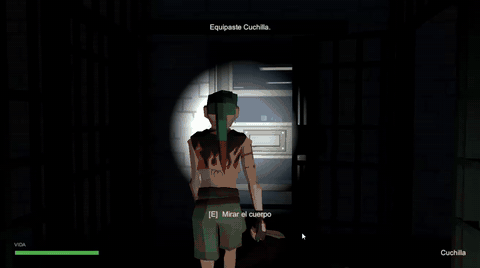
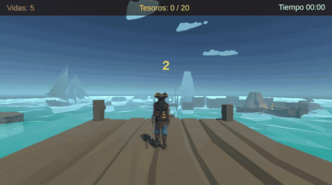
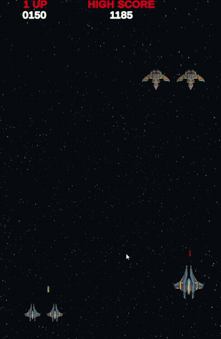
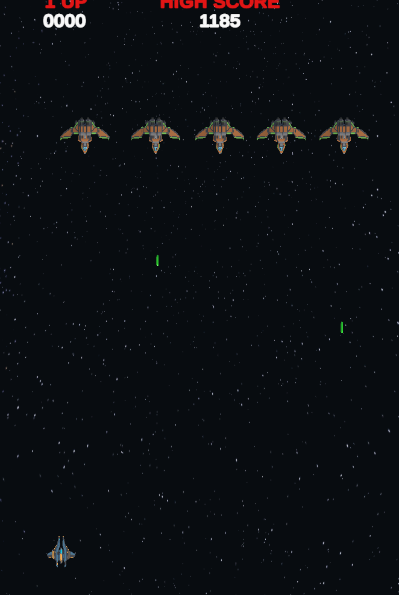

# Videojuegos en Unity

Tres juegos desarrollados para el ramo **Desarrollo de Videojuegos** de Ingeniería
Civil Informática en la UCSC (2026), en dupla con
[Luis Felipe Núñez](https://github.com/lufenunez). Nos repartimos el trabajo de
forma pareja en todos: programación de scripts en C#, integración de assets,
diseño de niveles y pruebas.

> Este repositorio es una vitrina: muestra cada juego con capturas y una
> descripción. El código no se publica porque los proyectos usan paquetes de
> assets con licencia que no permite redistribuirlos.

| Juego | Género | Estado de la vitrina |
|---|---|---|
| [Hollow Devotion](#hollow-devotion) | Survival horror en tercera persona | Capturas pendientes |
| [El Tesoro de Barba Negra](#el-tesoro-de-barba-negra) | Plataformas | Capturas pendientes |
| [Galaga3D](#galaga3d) | Shooter espacial arcade | ✅ |

---

## Hollow Devotion

**Survival horror en tercera persona.** Una noche que se sale de control: la
comisaría está tomada por infectados. Juegas como **Vera**, una detenida que escapa
de su celda y debe abrirse paso entre zombis, resolver puzles y administrar
munición, armas y recursos escasos para encontrar la salida.

<!-- CAPTURAS Y GIF PENDIENTES

-->

`Unity` `C#` `Tercera persona` `IA de enemigos` `Inventario y recursos` `Puzles`

---

## El Tesoro de Barba Negra

**Juego de plataformas.** Controlas a un pirata que salta obstáculos en el mar
mientras recolecta gemas para llegar al tesoro.

<!-- CAPTURAS Y GIF PENDIENTES

-->

`Unity` `C#` `Plataformas` `Física de salto` `Coleccionables`

---

## Galaga3D

**Shooter espacial al estilo arcade clásico.** Fue el primer desafío del ramo:
construir un juego en Unity 3D con una cámara cenital, de arriba hacia abajo,
para que se juegue y se vea como un arcade en 2D. Incluye oleadas de enemigos
con distintos patrones, disparos, explosiones, vidas y puntaje.

  
  
  

`Unity` `C#` `Cámara cenital` `Oleadas de enemigos` `Puntaje`

*Proyecto académico sin fines comerciales, inspirado en el clásico arcade de los
años 80.*

---

## Equipo

| Integrante | GitHub |
|---|---|
| Luis Felipe Núñez | [@lufenunez](https://github.com/lufenunez) |
| Manuel Cisternas | [@Maanuus](https://github.com/Maanuus) |
